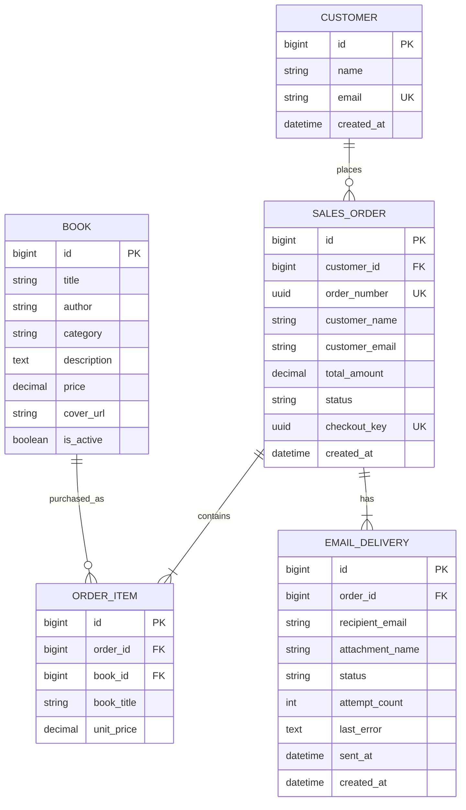

# Bookstore ER Diagram

Author and category are stored directly in the Book table. The shopping bag is stored in a Django session.

The diagram shows the five business tables. Django also creates framework tables for authentication, sessions, and administration logs. Primary keys use Django’s default `id` field. The checkout transaction ensures that every submitted order has order items and an email task. Order items have a unique constraint on `(order_id, book_id)`, allowing one digital copy of each title per order.
